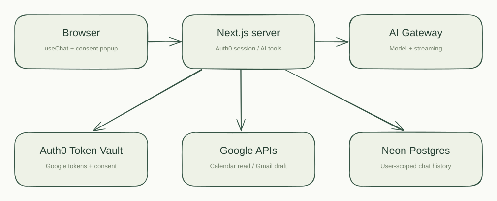

# Orbit · Google Token Vault

**Repository:** [focusOtter/google-token-vault](https://github.com/focusOtter/google-token-vault)

A calm conversational assistant that reads Google Calendar and creates Gmail **drafts, never sends**, using Google tokens managed by **Auth0 Token Vault**. No CIBA or asynchronous approval.

**Topics:** auth0, token-vault, nextjs, ai-sdk, google-calendar, gmail, neon, drizzle, vercel-ai-gateway



Generate this diagram with `pnpm diagram`: `scripts/architecture.mjs` uses the Excalidraw npm package's `exportToSvg` for the diagram shapes, then adds accessible SVG text labels and writes `docs/architecture.svg`.

## Stack and API names

- Next.js 16 App Router, TypeScript, React 19, Tailwind 4.
- `@auth0/nextjs-auth0` **4.33.0**: `Auth0Client` in `lib/auth0.ts`, `auth0.middleware()` in `proxy.ts` (Next.js 16's middleware convention).
- `@auth0/ai-vercel` **5.1.1**, `@auth0/ai` **6.0.3**: `Auth0AI.withTokenVault`, `getAccessTokenFromTokenVault`, `TokenVaultError`, `TokenVaultInterrupt.isInterrupt`, `setAIContext`, `withInterruptions`, `errorSerializer`, `useInterruptions`, and the interruption's `resume()`.
- AI SDK **6.0.333**, `@ai-sdk/react` **3.0.336**: latest compatible major versions. npm latest AI SDK 7 is outside Auth0 AI 5.1.1's supported peer range. Uses `inputSchema`, streaming `useChat`, `DefaultChatTransport`, `streamText`, and a plain AI Gateway model string.
- Neon Postgres + Drizzle: `chats` and `messages`, with ownership checked against the authenticated Auth0 `sub` before reads/writes.

## Setup

Use Node 24 LTS via nvm and pnpm:

```sh
source ~/.nvm/nvm.sh
nvm install --lts
corepack enable
pnpm install
cp .env.example .env.local
openssl rand -hex 32 # use as AUTH0_SECRET
```

### Auth0 application

Create a **Regular Web Application** using client-secret authentication. Configure:

| Setting | Local value |
| --- | --- |
| Allowed Callback URLs | `http://localhost:3000/auth/callback` |
| Allowed Logout URLs | `http://localhost:3000` |
| Allowed Web Origins | `http://localhost:3000` |
| Grant types | Authorization Code, Refresh Token, **Token Vault** (`urn:auth0:params:oauth:grant-type:token-exchange:federated-connection-access-token`) |

Enable **Token Vault / Connected Accounts** in your tenant. Authorize the application for the **Auth0 My Account API**, including **`create:me:connected_accounts`**, used internally by the SDK's connect-account flow. No Management API token is needed. This sample does not list/delete connected accounts and does not request those My Account scopes.

`enableConnectAccountEndpoint: true` mounts `/auth/connect` through middleware. The SDK obtains its My Account API access token internally. Login requests `openid profile email offline_access`; the session **must contain an Auth0 refresh token**. Enable offline access in the applicable API/connection configuration and re-login after changing grants/scopes. Do not set a Google audience at login: Google tokens come from Token Vault.

### Google social connection

1. Create a Google Cloud OAuth web client. Enable **Google Calendar API** and **Gmail API**. Configure Google's consent screen; for a testing app add your account as a test user. Production use of Gmail's restricted scopes requires Google's verification/security requirements.
2. Use your **own Google client ID and secret**, not Auth0 development keys. Google's authorized redirect URI must match the callback displayed by the Auth0 connection, usually `https://YOUR_AUTH0_DOMAIN/login/callback`.
3. Enable a Google social connection for this Auth0 application. The default name is **`google-oauth2`**; set `AUTH0_GOOGLE_CONNECTION` to use a dedicated connection (for example, `google-token-vault`) without changing a shared demo connection.
4. Enable **Token Vault** on the connection and **Offline Access in Connection Permissions** (required by Connected Accounts). Allow both scopes:
   - `https://www.googleapis.com/auth/calendar.events.readonly`
   - `https://www.googleapis.com/auth/gmail.compose`
5. The popup requests both scopes with `access_type=offline` and `prompt=consent`. Approve both. Login may use any enabled connection; Google is connected on demand.

See [SDK Connected Accounts](https://github.com/auth0/nextjs-auth0/blob/main/EXAMPLES.md#connected-accounts) and [Auth0 AI samples](https://github.com/auth0-samples/auth0-ai-samples/tree/main/call-apis-on-users-behalf/others-api/vercel-ai-next-js). If My Account API or the Token Vault grant is unavailable, enable the tenant feature first; legacy federated APIs are not a fallback.

### Neon and AI Gateway

Create a Neon Postgres database and copy its TLS connection string. Create a Vercel AI Gateway key for local development. On Vercel use the project's OIDC integration instead of a long-lived key.

| Environment variable | Purpose |
| --- | --- |
| `AUTH0_DOMAIN` | Tenant domain without protocol |
| `AUTH0_GOOGLE_CONNECTION` | Google connection name; defaults to `google-oauth2` |
| `AUTH0_CLIENT_ID` | Regular Web Application ID |
| `AUTH0_CLIENT_SECRET` | Server-side application secret |
| `AUTH0_SECRET` | Random 32-byte hex session encryption secret |
| `APP_BASE_URL` | `http://localhost:3000`, or deployed origin |
| `DATABASE_URL` | Neon Postgres URL with `sslmode=require` |
| `AI_GATEWAY_API_KEY` | Local Gateway key; omit on Vercel with OIDC |
| `AI_MODEL` | Optional, defaults to `openai/gpt-4.1-mini` |

Drizzle CLI reads the shell environment, **not `.env.local` automatically**:

```sh
set -a; source .env.local; set +a
pnpm db:migrate
pnpm dev
```

Open `http://localhost:3000`, sign in, and ask about your week. Click **Connect Google** and allow popups. After consent the popup closes and resumes the interrupted tool automatically. Cancelling can cause another consent prompt. Provide a recipient, subject and body to create an email draft, then review it in Gmail Drafts.

**Draft-only is enforced by code, not Google's scope:** `gmail.compose` technically also allows sending. This sample implements only the drafts API endpoint and has no send tool or send endpoint.

For Vercel deployment, configure the production Auth0 callback/logout/origin entries, base URL, database migration and Gateway/OIDC. No public deployment is included.

## How it works

1. Auth0 middleware manages encrypted session cookies. Both the chat page and POST route independently require a session.
2. `useChat` sends streaming UI messages to `/api/chat`. The server checks request origin, validates messages, and verifies chat ownership before saving history. Tokens are not stored in chat tables.
3. `withTokenVault` exchanges the session's Auth0 refresh token for a Google access token with the requested scopes. Only the wrapped tool context can call `getAccessTokenFromTokenVault`.
4. A missing account or scope produces a Token Vault interruption. `errorSerializer` sends it to `useInterruptions`; the UI follows the samples' `/auth/connect` popup pattern with repeated `scopes` parameters. Its `resume()` marks the tool for re-execution by `withInterruptions` after consent.
5. Calendar reads the primary calendar for the next seven days by default, up to 100 events with a truncation indicator. Gmail constructs Unicode-safe MIME and POSTs **only** to `/gmail/v1/users/me/drafts`.
6. The model sees tool results, never credentials. Completed UI messages/tool parts are persisted in Neon; the sidebar reopens chats scoped to the current user's `sub`.

## Development checks

```sh
pnpm test
pnpm lint
pnpm build
pnpm db:generate # after schema edits; review and commit migrations
pnpm diagram     # regenerate committed SVG
```

Vitest mocks Google fetch calls and the token getter, covering normal, empty, error, and MIME/header safety cases. Database helper tests assert actual Drizzle ownership SQL predicates. Unit tests and build do not require live credentials; authenticated runtime does.

### Sample boundaries

- No CIBA, async approvals, calendar writes, email sending, or background jobs.
- History includes personal calendar/email content. Add retention/deletion policies before production; there is no chat deletion UI.
- Tool output is untrusted. A system prompt is not a complete prompt-injection defense. Always review drafts in Gmail.
- Draft creation is not idempotent: manually retrying a completed request can create another draft. There are no automatic Google write retries. Add durable per-tool-call idempotency/concurrency controls before production.
- Live Auth0, Google, Neon, and Gateway behavior requires configured credentials. Google 403 errors may mean disabled APIs rather than missing consent; check Google Cloud if reconnecting does not help.
